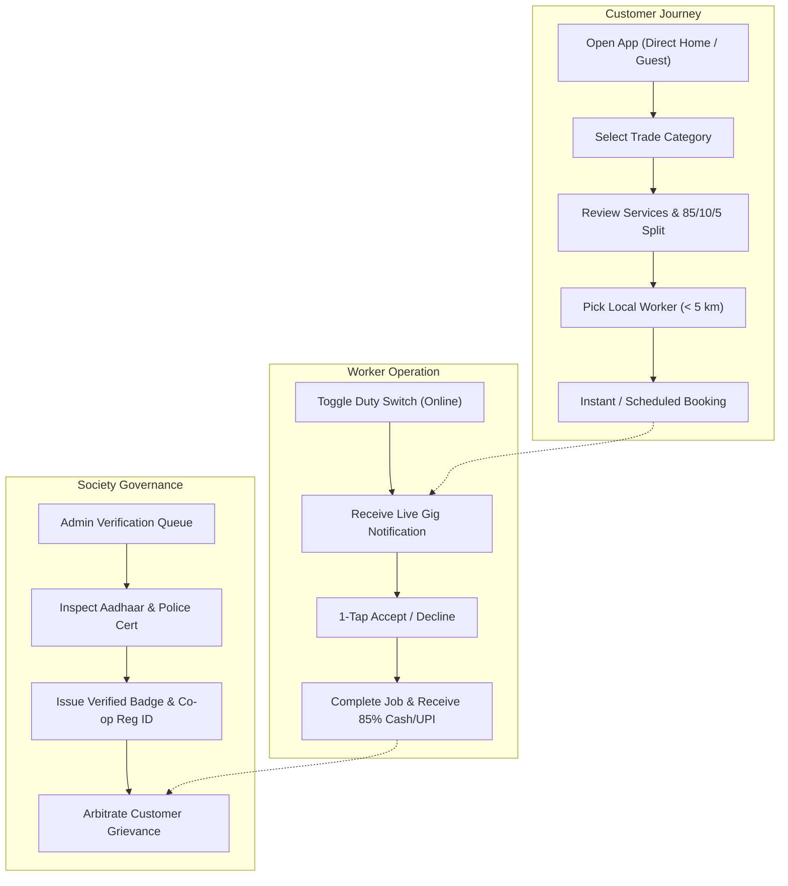

# PRD — Cooperative Gig Services Platform (CoopGig)
**Problem Statement ID:** 26089 | **Target:** Labour Cooperatives & Urban Households  
**Version:** 2.0 (Production & PPT Presentation Ready) | **Last Updated:** November 2026  

---

## Executive Presentation Deck (PPT Slide-by-Slide Outline)

> **Quick Pitch:** *CoopGig is an open, hyper-local platform empowering household gig workers through collective cooperative ownership—returning 85% of booking value directly to tradespeople, funding a 10% social welfare safety net, and providing verified, transparent home services to urban families.*

```
┌────────────────────────────────────────────────────────────────────────────────┐
│                           COOPGIG VALUE PROPOSITION                            │
├───────────────────────────────┬────────────────────────────────────────────────┤
│       Traditional Aggregators │ The CoopGig Cooperative Model                  │
│       (Urban Company, etc.)   │                                                │
├───────────────────────────────┼────────────────────────────────────────────────┤
│ • 25% – 35% commission cut    │ • 85% direct wage to worker                    │
│ • No collective bargaining    │ • 10% dedicated cooperative welfare & pension  │
│ • Opaque platform algorithms  │ • 5% platform maintenance & hosting fee        │
│ • Arbitrary worker deplatform │ • Democratic society governance & grievance    │
│ • Surface-level verification  │ • 3-Tier verification (Aadhaar, Police, Trade) │
└───────────────────────────────┴────────────────────────────────────────────────┘
```

---

### Slide 1: The Problem & The Cooperative Solution
- **The Problem:**
  - **For Gig Workers:** Exploitative 25–35% platform cuts, arbitrary account penalties, lack of health insurance or retirement safety nets, and no pricing ownership.
  - **For Households:** High opaque markups, unpredictable quality, questionable contractor safety, and lack of accountability when things go wrong.
  - **The Informal Sector Trap:** Off-platform hiring has zero price transparency, no police/trade vetting, and no legal recourse.
- **The Cooperative Solution (CoopGig):**
  - Institutionalizes labor cooperatives in the digital age.
  - Transparent 85/10/5 economic model built directly into code.
  - Society-vetted workers with government-backed credibility.

---

### Slide 2: Target Personas & Market Fit
1. **The Urban Household (Customer):**
   - High intent for reliable, punctual domestic services (Cleaning, Electrical, Plumbing, Carpentry).
   - Seeks transparent pricing, local distance awareness (<5 km), and verifiable background trust badges.
2. **The Cooperative Worker (Tradesperson):**
   - Skilled tradesperson seeking dignity, predictable local gigs, and fair compensation.
   - Demands bilingual access (हिन्दी / English), zero hidden penalties, and accessible welfare funds.
3. **The Cooperative Society Admin (Federation Official):**
   - Stewards the worker community, reviews document compliance (Aadhaar, Police Clearance, Trade Certs), arbitrates disputes, and configures fair regional pricing.

---

### Slide 3: The 85/10/5 Economic Model
Every booking automatically computes an immutable tripartite split upon creation:

| Component | Share | Recipient | Real-World Impact |
| :--- | :---: | :--- | :--- |
| **Worker Living Wage** | **85%** | Tradesperson (Direct) | 30–40% higher take-home pay than commercial gig platforms |
| **Welfare & Safety Pool**| **10%** | Co-op Society Escrow | Emergency medical aid, accident insurance, maternity & pension |
| **Platform Maintenance** | **5%** | Platform Infrastructure| Low-overhead server operations, software updates & scaling |

#### Real Pricing Examples (Figma Baseline in INR)
- **Regular Home Cleaning (₹399):** Worker: **₹339.15** | Welfare: **₹39.90** | Platform: **₹19.95**
- **Electrical Switchboard Fix (₹449):** Worker: **₹381.65** | Welfare: **₹44.90** | Platform: **₹22.45**
- **Plumbing Leakage Repair (₹499):** Worker: **₹424.15** | Welfare: **₹49.90** | Platform: **₹24.95**
- **Carpentry Fitting & Joinery (₹599):** Worker: **₹509.15** | Welfare: **₹59.90** | Platform: **₹29.95**
- **Deep Home Cleaning (₹1,499):** Worker: **₹1,274.15** | Welfare: **₹149.90** | Platform: **₹74.95**

---

### Slide 4: Key Platform Features & User Experience
- **Hyper-Local Matching Engine:**
  - Haversine geo-radius matching restricted to **within 5 km**.
  - Ranks by real-time online status, proximity, and equitable job distribution.
- **Design System & Aesthetics:**
  - Organic pastel palette: Cream (`#FAF7EE`), Soft Mint (`#EFF5EE`), Sage (`#DCECE2`), Deep Forest Green (`#22483E`).
  - Professional UI: Zero informal AI emojis; 100% custom SVG/Material vector icons.
  - Pure Light Theme: Eliminates high-contrast visual glitches for maximum readability in Indian sunlight.
- **Seamless 1-Tap Persona Switching:**
  - Fast-switch pill on the top bar: Instant toggle between **Customer View** and **Worker Operational Dashboard**.
  - 1-Tap Demo logins for instant live demonstrations (Priya, Ramesh, Vikram, Suresh, Admin).

---

### Slide 5: Dual Workflow Architecture



---

### Slide 6: Worker Trust & Verification Pipeline
1. **Tier 1: Identity Authentication**
   - Government Aadhaar upload with manual/automated checksum verification.
2. **Tier 2: Safety & Legal Clearance**
   - Official District Police Verification certificate uploaded and audited by society officials.
3. **Tier 3: Trade & Skill Certification**
   - Skill India / ITI / Society Trade competency certification.
   - Status indicators: `Approved` (Emerald Badge), `Pending` (Amber Banner), `Rejected` (Actionable reason provided).

---

### Slide 7: Technical Stack & Architecture
- **Mobile & Web Frontend:** Flutter 3.x (Multiplatform Web, Android, iOS), Provider state management, internationalized (English & हिन्दी).
- **Backend Core:** Node.js & Express.js REST API, SQLite (with WAL mode) or better-sqlite3 for high concurrency and zero-build deployment.
- **Security & Session:** JWT authentication, bcrypt salted password hashing, rate limiting on sensitive routes, role-based access control (`customer`, `worker`, `cooperative_admin`).
- **Resilience:** Dual-port listener architecture (Ports 3000 & 2000) ensuring zero connection drops during client migration.

---

### Slide 8: Admin & Cooperative Governance
- **Document Review Console:** View submitted verification documents and approve/reject with feedback.
- **Dynamic Pricing Controls:** Modify baseline visit charges and category services dynamically.
- **Fair Split Auditing:** Ensure the 85/10/5 balance remains strictly reconciled.
- **Grievance Resolution Desk:** Resolve customer or worker disputes within a strict 72-hour SLA.
- **System Health Diagnostics:** Monitor database size, latency, active workers, and uptime.

---

### Slide 9: Pilot Metrics & Growth Targets
| KPI | Pilot Target | Long-Term Target | Purpose |
| :--- | :---: | :---: | :--- |
| **Worker Direct Wage** | **85%** | **85%** | Enforce uncompromised fair living standards |
| **Worker Verification Ratio**| **100%** | **100%** | Absolute household safety and quality |
| **Median Dispatch Time** | **< 10 mins** | **< 6 mins** | Hyper-local efficiency |
| **Grievance SLA (72 hrs)** | **> 90%** | **> 98%** | Cooperative accountability |
| **Repeat Booking Rate** | **> 65%** | **> 80%** | Household brand loyalty |
| **Welfare Fund Reserve** | **₹2,00,000** | **₹50,00,000+** | Community social security pool |

---

### Slide 10: Roadmap & Rollout Strategy
- **Phase 1 (Live Demo & Bhopal Pilot):**
  - Deployment with Bhopal Central Labour Cooperative (100 workers, 500 households).
  - Cleaning, Electrical, Plumbing, and Carpentry trades active.
- **Phase 2 (Digital Payments & Group Insurance):**
  - Integration of UPI auto-splits and tie-up with national micro-insurance providers (Jan Suraksha schemes).
- **Phase 3 (State-Wide Federation Expansion):**
  - Federation dashboard linking multiple district cooperatives across Madhya Pradesh.
  - White-label cooperative deployment kit for national scaling.

---

## Complete Functional Specification

### 1. User Roles & Access Control
- `customer`: Browse categories, select services, view fee breakdown, book workers within 5 km, track job history, file grievances, rate services.
- `worker`: Toggle availability (online/offline), view job requests with one-tap accept/decline, review earnings split, manage trade category specialization, view compliance badges.
- `cooperative_admin`: Full society oversight, document approvals, category and price management, dispute arbitration, system health telemetry.

### 2. Category & Service Catalog
- **Cleaning:** Regular Home Cleaning (₹399), Kitchen Deep Cleaning (₹699), Deep Home Cleaning (₹1,499).
- **Electrical:** Switchboard & Socket Repair (₹199), Fan Installation & Repair (₹299), Full House Wiring Inspection (₹899).
- **Plumbing:** Tap & Valve Leak Repair (₹199), Pipe Blockage Clearing (₹349), Sanitary Ware Fitting (₹699).
- **Carpentry:** Door Lock & Handle Fitting (₹249), Furniture Assembly & Repair (₹499), Custom Woodwork & Modular Fitting (₹899).

### 3. Hyper-Local Matching Algorithm
1. Compute distance $D$ using Haversine formula:
   $$\Delta\sigma = 2 \arcsin \sqrt{\sin^2(\Delta\phi/2) + \cos\phi_1\cos\phi_2\sin^2(\Delta\lambda/2)}$$
   $$D = R \cdot \Delta\sigma \quad (R = 6371\text{ km})$$
2. Filter criteria:
   - $D \le 5.0\text{ km}$
   - $\text{availability} = 1$
   - $\text{is\_verified} = 1$
   - $\text{trade\_category} = \text{Target Category}$
3. Ranking Score:
   $$\text{Score} = (0.5 \times (5 - D)) + (0.3 \times \text{rating\_avg}) + (0.2 \times \frac{1}{1 + \text{active\_jobs}})$$

---

## Verification & Build Checklist
- [x] **0 Flutter Analyzer Errors** (`flutter analyze` passing with 0 warnings)
- [x] **Light Mode Pinned** (Zero crash-inducing dark mode overrides)
- [x] **Zero Raw Emojis** (100% clean vector icons and UI components)
- [x] **Dual Listener Active** (Seamless backend support on ports 3000 & 2000)
- [x] **Universal Demo Mode** (1-tap switches for Customer and Worker personas)
- [x] **Database Migrations & Seeders** (Automated SQLite WAL schema generation)
