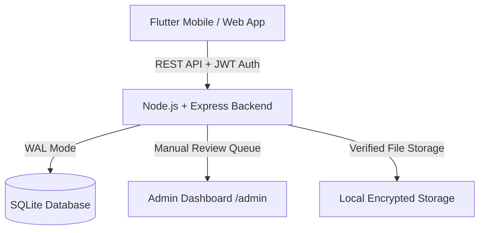

# Cooperative-Gig-Services-Platform

> **Cooperative Gig Services Platform (Problem Statement ID 26089)**  
> A cooperative-backed home services marketplace where every tradesperson is verified by their local labour cooperative, dispatches hyper-locally (under 5 km), and receives 85% of each booking directly as a fair living wage.

---

## 🌟 Overview & Vision

Private gig platforms frequently levy high commissions (25%–35%), exercise opaque algorithmic control over pricing, and offer limited recourse. Informal hiring faces the opposite dilemma: zero verification, uncertain pricing, and no insurance.

**Cooperative Gig Services Platform** bridges this gap:
* **85% Worker Living Wage**: 85% of every booking total is routed directly to the worker.
* **10% Cooperative Welfare Fund**: 10% funds group health cover, accident insurance, and social security.
* **5% Platform Operations**: Low-overhead maintenance and dispatch hosting.
* **100% Society Verification**: Workers are vetted for Government ID (Aadhaar), Police Clearance, and Trade Skills/Certification.
* **Hyper-local Matching (≤ 5 km)**: Fast dispatch within cooperative society jurisdiction.

---

## 🏗️ Architecture



### 1. Flutter Frontend (`APP_frontend/coop_gig_app`)
* **Design Language**: Warm Cream-to-Sage gradient (`#FAF7EE` ➔ `#EFF5EE` ➔ `#DCECE2`), Deep Forest Green (`#22483E`), Coral terracotta location pin, rounded surface cards.
* **Localization**: Full English and Hindi support (`en` / `hi`).
* **Roles**: Dynamic UI adapting to **Customer**, **Worker**, and **Admin**.
* **Responsive**: Zero-overflow layouts tested across small mobile viewports (320px–360px), varying text scaling, and virtual keyboards.

### 2. Node.js + SQLite Backend (`Backend`)
* **Framework**: Express.js + `better-sqlite3` (WAL mode enabled).
* **Database**: Automated schema migrations (`001_initial.js`) and realistic seed data (`002_seed.js`).
* **Security**: JWT Bearer authentication, bcrypt-hashed passwords, role-based route guards (`customer`, `worker`, `cooperative_admin`), file upload validation.
* **Admin Portal**: Integrated web console at `/admin` for document verification, dispute handling, and commission split configuration.

---

## 💰 85 / 10 / 5 Fair Fee Split Model

Every booking calculates and locks its fee split on creation:

| Component | Default Share | Recipient | Purpose |
| :--- | :---: | :--- | :--- |
| **Worker Wage** | **85%** | Worker (Direct) | Guaranteed fair living wage |
| **Welfare Pool** | **10%** | Cooperative Society | Insurance, emergency medical & social security |
| **Platform Ops** | **5%** | Operations | Infrastructure, maintenance & support |

*Example: ₹399 Regular Home Cleaning*
* Worker direct payout: **₹339.15**
* Welfare fund deposit: **₹39.90**
* Platform maintenance: **₹19.95**

---

## 📱 Key Features by Role

### 1. Customer (Household)
* **Explore**: Instant society switcher (e.g., *Bhopal Central Co-op*), trade service categories (Cleaning, Electrical, Plumbing, AC Service, Carpentry).
* **Trust Badges**: 100% Verified, Fair Wage Split, Welfare Backed indicators.
* **Hyper-local Dispatch**: Live worker cards showing distance (under 5 km), ratings, and visit fees.
* **Transparent Booking**: View the 85/10/5 fee split before confirming; choose immediate or scheduled slots.
* **Recourse**: In-app grievance desk with guaranteed resolution tracking within 72 hours under Cooperative by-laws.

### 2. Cooperative Worker
* **Dispatch Desk**: Real-time incoming job requests with one-tap accept ("काम स्वीकार करें") and decline.
* **Availability Control**: Online/Offline toggle with immediate status broadcast.
* **Document Desk**: Upload Aadhaar, Police Verification, and Trade Certificate with live review status.
* **Transparent Receipts**: Detailed ledger of completed jobs showing direct 85% payouts and accumulated welfare contributions.

### 3. Cooperative Admin
* **Verification Desk**: Document review queue to inspect and approve/reject worker credentials.
* **Pricing & Split Management**: Society-level control over service rates and percentage splits.
* **Grievance Resolution**: Review customer or worker complaints and record resolution notes.

---

## 🚀 Getting Started

### Prerequisites
* **Node.js**: v18 or later (Node 20+ recommended)
* **Flutter SDK**: 3.22+ or later

---

### Step 1: Run the Backend Server

```bash
cd Backend
npm install
node server.js
```

The server will automatically run migrations, seed initial data, and listen on:
* **API Base URL**: `http://localhost:3000/api`
* **Admin Dashboard**: `http://localhost:3000/admin`

#### Demo Accounts
| Role | Email / Login | Password | Notes |
| :--- | :--- | :--- | :--- |
| **Customer** | `roshan@example.com` | `password123` | Household user in Bhopal Central |
| **Worker** | `ramesh@example.com` | `password123` | Electrician (Verified, Welfare Active) |
| **Worker** | `sunita@example.com` | `password123` | Cleaner (Verified) |
| **Admin** | `admin@coopbhopal.in` | `admin123` | Cooperative Society Admin |

---

### Step 2: Run the Flutter Mobile App

```bash
cd APP_frontend/coop_gig_app
flutter pub get
flutter run -d chrome    # Or flutter run -d android / ios / windows
```

---

## 📂 Project Structure

```
├── Backend/
│   ├── admin/             # Cooperative admin dashboard HTML & assets
│   ├── middleware/        # JWT auth & role protection guards
│   ├── migrations/        # SQLite schema migrations & seed data
│   ├── routes/            # REST API route handlers (auth, workers, bookings, etc.)
│   ├── services/          # Business logic & 85/10/5 fee calculations
│   ├── config.js          # Default ratios, ports, and paths
│   └── server.js          # Express app entrypoint
│
├── APP_frontend/
│   └── coop_gig_app/
│       ├── lib/
│       │   ├── config/      # Palette, typography, localization, assets
│       │   ├── controllers/ # State management (Auth, Booking, Worker, Category)
│       │   ├── models/      # Data models (Booking, User, Worker, Service, Grievance)
│       │   ├── services/    # HTTP client & API connector
│       │   ├── views/       # Responsive mobile views
│       │   └── widgets/     # Reusable UI widgets & trust strips
│       └── pubspec.yaml
│
├── PRD.MD                 # Product Requirements Document
├── .gitignore             # Git ignore configuration
└── README.md              # Project documentation
```

---

## 📄 License
Licensed under the [MIT License](LICENSE).
